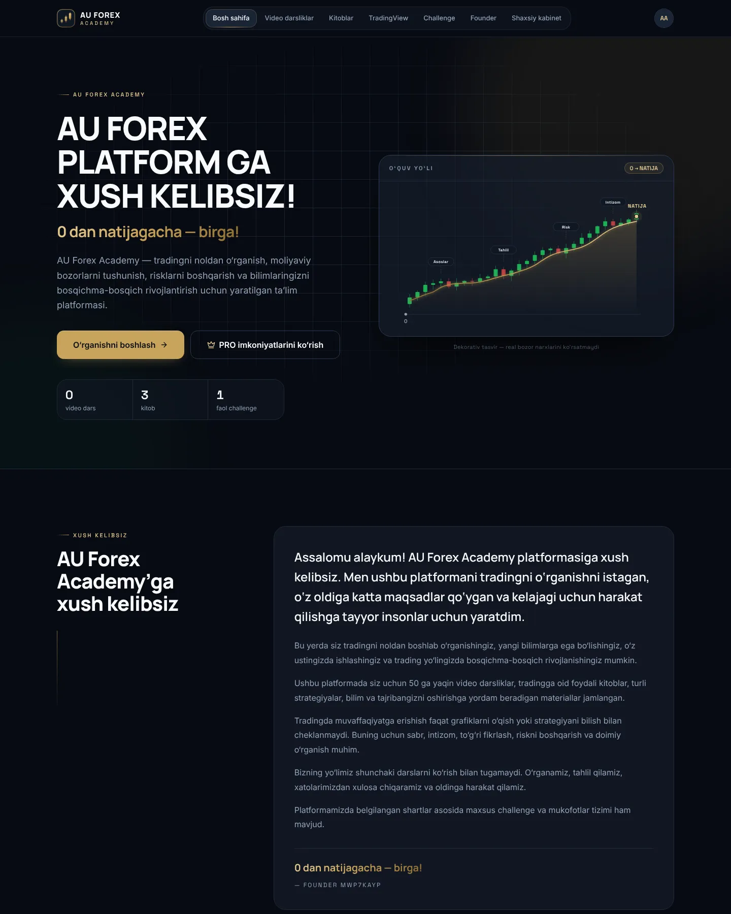
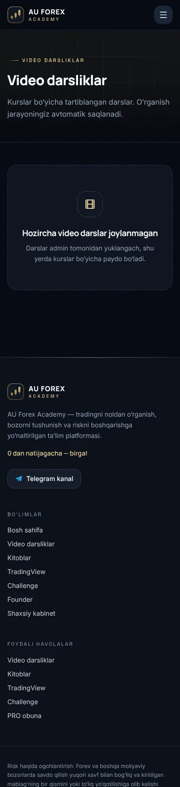
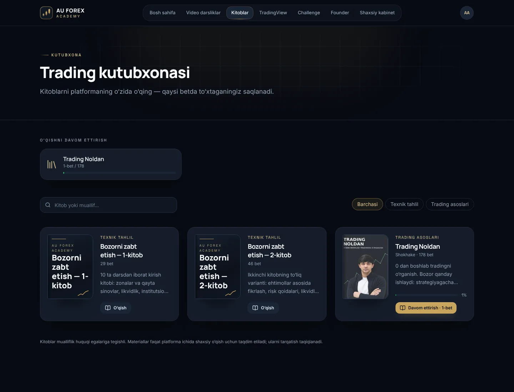
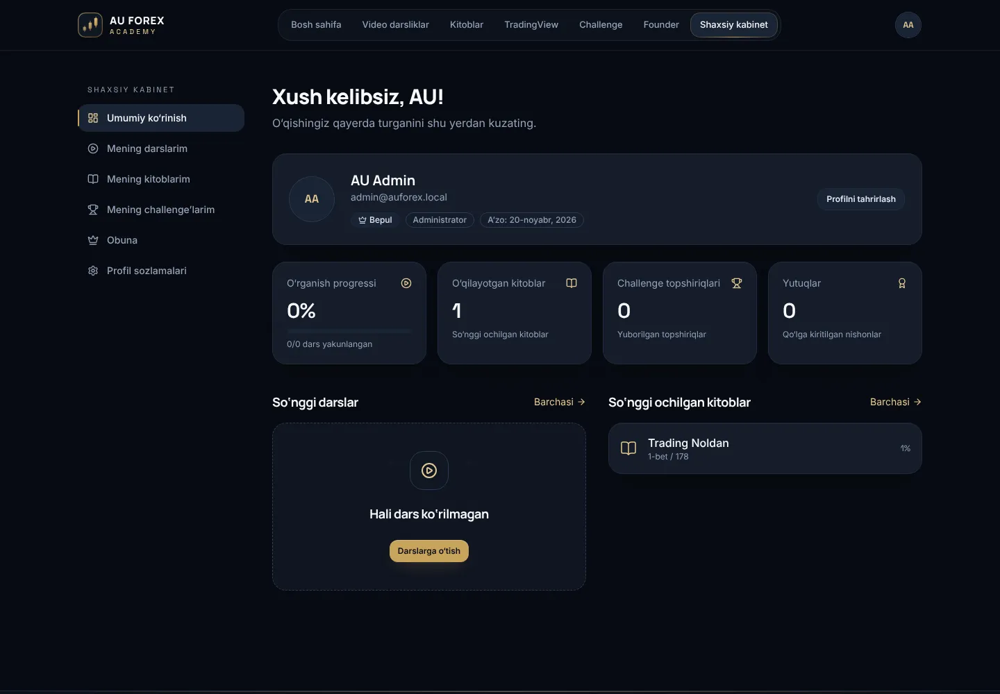
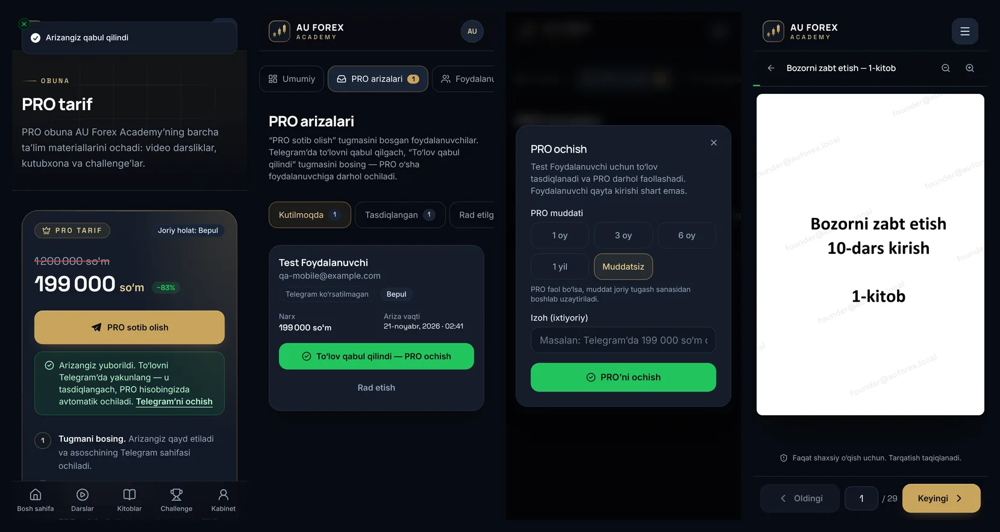
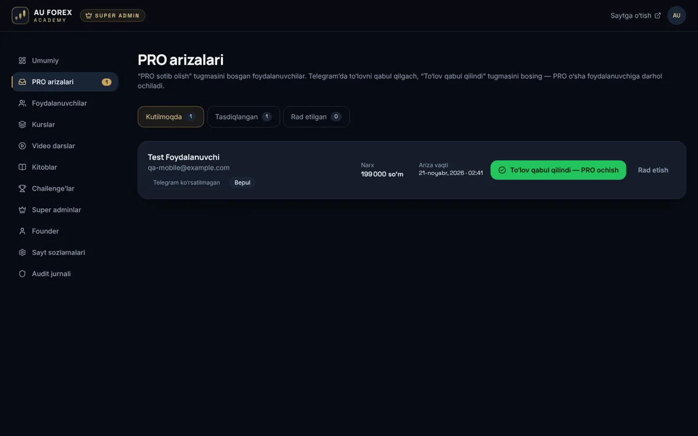

# AU FOREX ACADEMY — AU Forex Platform

**0 dan natijagacha — birga!**

A production-grade Forex education platform in Uzbek (Latin): public website, secure authentication, PRO-protected video lessons and PDF library, TradingView charts, an educational challenge system, a personal dashboard and a single **Super admin panel** (`/super-admin`). There is no online checkout: the “PRO sotib olish” button opens the founder’s Telegram and files a **PRO request**; after the founder confirms the payment in Telegram, one click in the panel opens PRO for that user. The subscription architecture is ready for Click/Payme later.



| | |
|---|---|
|  |   |





---

## Contents

1. [Tech stack](#tech-stack)
2. [Features by section](#features-by-section)
3. [Quick start (local)](#quick-start-local)
4. [Super admin, PRO purchase and content](#super-admin-pro-purchase-and-content)
5. [Environment variables](#environment-variables)
6. [Scripts](#scripts)
7. [Testing](#testing)
8. [Production deployment](#production-deployment)
9. [Security model](#security-model)
10. [Project structure](#project-structure)
11. [Adding a payment provider later](#adding-a-payment-provider-later)
12. [Assumptions and decisions](#assumptions-and-decisions)
13. [Incomplete features and missing credentials](#incomplete-features-and-missing-credentials)

---

## Tech stack

| Layer | Choice (version tested) |
|---|---|
| Framework | Next.js **16.4** (App Router, Turbopack, `proxy.ts`), React **19.3**, TypeScript **5.9** (strict + `noUncheckedIndexedAccess`) |
| UI | Tailwind CSS **4.3**, shadcn/ui-style components on Radix (`radix-ui` 1.8), Lucide icons, Motion **14**, Sonner toasts |
| Forms / validation | React Hook Form 7.92 + Zod **4.6** (the same schemas run on the server) |
| Client state | Zustand 5 (only for UI preferences — chart instrument/timeframe; never for auth or access) |
| Database | PostgreSQL 16 + Prisma ORM **7.10** (`prisma-client` generator, `@prisma/adapter-pg`) |
| Auth | Better Auth **1.7** — email/password, scrypt hashing, DB sessions, password reset, email verification, DB-backed rate limiting |
| PDF | pdf.js (`pdfjs-dist` 6.5) canvas reader, worker served from our own origin |
| Email | Nodemailer (any SMTP provider) |
| Fonts | Manrope (display), Inter (body), Space Grotesk (data) — self-hosted via Fontsource, no Google Fonts at runtime |
| Tests | Vitest 5 (unit) + Playwright 1.65 (end-to-end) |

---

## Features by section

| Navigation item | Route | What it does |
|---|---|---|
| Bosh sahifa | `/` | 13 sections: hero with the signature "0 → Natija" animated growth path (decorative, no prices), the academy's welcome message (verbatim), advantages with **live counts from the DB**, learning roadmap, lesson & book previews, TradingView and challenge intros, PRO benefits, founder preview, FAQ, final CTA, footer with risk disclaimer |
| Video darsliklar | `/lessons`, `/lessons/[slug]` | Non-PRO → `ProAccessGate`. PRO → categories, search, filtering, course grouping, thumbnails, durations, per-lesson & overall progress, "continue watching", video player (HTTP Range streaming), previous/next, "mark complete" |
| Kitoblar | `/books`, `/books/[slug]` | Same gate. PRO → covers, authors, page counts, categories, search, filter, reading progress, continue reading, responsive pdf.js reader (page nav, zoom, fullscreen, keyboard, personalised watermark) |
| TradingView | `/tradingview` | Registered users (admin can switch to PRO-only). Official embed widget, instrument + timeframe controls, loading skeleton, fallback when the widget fails, glossary, trading sessions, risk disclaimer |
| Challenge | `/challenge`, `/challenge/[slug]` | PRO required to participate. Quizzes (auto-graded), text/link/image submissions, dates, objectives, requirements, admin review, results, leaderboard, achievement badges, rewards shown **only** when published by an admin |
| Founder | `/founder` | Polished profile with clearly labelled placeholders until the admin fills in name, portrait, biography, mission, philosophy, message and social links |
| Shaxsiy kabinet | `/dashboard/*` | Overview, my learning, my books, my challenges + achievements, my subscription (status, start, expiry, upgrade), profile settings (name, avatar, bio, Telegram, experience, password change, verification email, sign out other devices) |
| — | `/subscription` | PRO benefits, price (~~1 200 000~~ **199 000 so‘m**, editable), **“PRO sotib olish”** → opens `https://t.me/uktambekovv` and records a PRO request; 3-step explanation. Clicking never grants PRO by itself |
| — | `/login`, `/register`, `/forgot-password`, `/reset-password`, `/verify-email` | Full auth flows in Uzbek |
| — | `/super-admin/*` | **Super admin panel** (the only admin panel; `/admin` no longer exists): overview with new PRO requests, **PRO arizalari** (approve → PRO opens / reject), users (search/filter, grant/revoke PRO, expiry, suspend, revoke sessions), courses & categories, lessons (upload with progress or YouTube/Vimeo/Bunny embed), books (PDF upload with automatic page count and cover), challenges (questions, rewards, publish/close, review submissions, results), super admins, founder profile, site settings (incl. price & purchase link), audit log |
| — | Phones | Bottom tab bar (Bosh sahifa · Darslar · Kitoblar · Challenge · Kabinet/Panel), 44 px+ touch targets, 16 px inputs (no iOS zoom), safe-area aware header/bars, full-width lesson video, PDF reader with a thumb-reach page bar and swipe to turn pages, card layouts and condensed tables in the panel, installable web app manifest + icons |

---

## Quick start (local)

**Prerequisites:** Node.js 20.9+ (22 LTS recommended) and PostgreSQL 16 — a local install, or Docker Desktop with `docker compose up -d db`. Step-by-step guide for Windows in Uzbek: [docs/ISHGA-TUSHIRISH.md](docs/ISHGA-TUSHIRISH.md).

Extract the ZIP into an **empty** folder (not over an older version — leftovers such as `app/admin` break the build; `npm run dev` detects them).

```bash
npm install                 # also runs `prisma generate` and copies the pdf.js worker
npm run setup               # creates .env, generates BETTER_AUTH_SECRET and a founder password (prints it)
npm run db:fix              # starts the Docker database (free port if 5432 is taken) and fixes DATABASE_URL
npx prisma migrate deploy   # creates the tables
npm run db:seed             # categories, settings, founder account "asadbek", the 3 supplied books
npm run doctor              # checks Node, .env, database, migrations, founder account, book files
npm run dev                 # http://localhost:3000 — panel: http://localhost:3000/super-admin
```

All commands work the same in Windows PowerShell, Git Bash, macOS and Linux. `npm run setup` never overwrites values you already have.

**Updating an existing install** (keeps the database, `.env` and `storage/`): extract the ZIP *over* the existing folder (the archive contains the `au-forex-academy/` folder, so extract it into the folder's parent), then run `rm -rf app/admin .next`, `npm install`, `npm run setup`, `npm run db:fix`, `npx prisma migrate deploy`, `npm run db:seed`, `npm run founder:password`, `npm run doctor`. Step by step (Uzbek): [docs/ISHGA-TUSHIRISH.md](docs/ISHGA-TUSHIRISH.md) → “Eski versiyani yangilash”.

**Database port.** `docker compose` publishes PostgreSQL on `DB_PORT` (default 5432). If 5432 is taken (common on Windows with a local PostgreSQL), use e.g. `DB_PORT="5433"` and the same port in `DATABASE_URL`; `npm run setup` copies the port from an existing `DATABASE_URL` automatically.

**Founder password.** The founder signs in with login `asadbek` and the `FOUNDER_PASSWORD` from `.env`. If the account already existed in the database with another password (for example created by an earlier seed), set it again with `npm run founder:password` (uses `FOUNDER_PASSWORD`, or pass one: `npm run founder:password Yangi-Parol-2026`).

**Testing on a phone.** Run `npm run dev`, connect the phone to the same Wi-Fi and open the *Network* address that Next.js prints (e.g. `http://192.168.1.23:3000`). In development, private network addresses are allowed for sign-in and hot reload; in production only `BETTER_AUTH_URL` and `TRUSTED_ORIGINS` are accepted.

**Panel address.** The Super admin panel is `/super-admin`. `/superadmin`, `/super_admin` and the old `/admin` redirect there.

Without SMTP settings, password-reset and verification emails are **printed to the dev server console** (never in production).

To change the schema later: edit `prisma/schema.prisma`, then `npm run db:migrate -- --name your_change`.

---

## Super admin, PRO purchase and content

### Roles

| Role | Can do |
|---|---|
| **SUPER_ADMIN** | The whole Super admin panel: PRO requests, users and PRO access, courses, lessons, books, challenges and reviews, other super admins, founder profile, site settings, audit log |
| **USER** | Learner; premium content depends on the PRO subscription |

There is one admin level. The former `ADMIN` role was merged into `SUPER_ADMIN` by migration `20261121130000_single_super_admin_pro_requests` (existing admins were promoted, nobody lost access). Roles are stored separately from subscription entitlement; super admins can always review premium content. Access is enforced in the layout, every page, every server action and every API route; the last active super admin can never be demoted or suspended.

### Founder account

`npm run db:seed` creates the founder account **Asadbek Uktambekov** with role `SUPER_ADMIN`, who signs in on `/login` with the **login** `asadbek` (or the email) and the password from `FOUNDER_PASSWORD` in `.env`. If `FOUNDER_PASSWORD` is empty on first creation, a strong password is generated and printed once by the seed. After the first sign-in: change the password (Shaxsiy kabinet → Profil sozlamalari) and set a real email there so password recovery works.

The founder profile shown on `/founder` (name, role, biography, mission, message, Instagram `@_uktambekovv`) is filled by the seed on installs where it is still empty and is editable in Super admin → Founder. Upload a portrait there — the page shows a neutral placeholder until then.

### How a user buys PRO (Telegram flow)

1. A signed-in user presses **“PRO sotib olish”** (on `/subscription`, in the PRO gate, on the homepage or in Shaxsiy kabinet → Obuna). The price is shown right above the button: ~~1 200 000 so‘m~~ **199 000 so‘m** with the discount badge. Guests are asked to register first so the request can be matched to an account.
2. The founder’s Telegram (`https://t.me/uktambekovv`) opens in a new tab and, in parallel, a `ProRequest` (status `PENDING`, price snapshot) is stored. Repeated clicks don’t create duplicates — the attempt counter goes up. The user sees “Arizangiz yuborildi”.
3. The request appears in **Super admin → PRO arizalari** (with a counter badge in the menu and a card on the overview): name, email, login, Telegram username from the profile, price, time.
4. After receiving the payment in Telegram, the founder presses **“To‘lov qabul qilindi — PRO ochish”**, chooses the duration (1/3/6 months, 1 year or *muddatsiz*; if PRO is already active it is extended from the current expiry) and an optional note. PRO opens for that user immediately — no re-login — and the action is written to the audit log. *Rad etish* marks the request rejected without touching the subscription.

Price, struck-through old price, currency, period label, purchase link, button text and the default duration are editable in **Super admin → Sayt sozlamalari → Obuna**. The purchase link must be `https://`.

### Other super admins and manual PRO

* `ADMIN_EMAIL`/`ADMIN_PASSWORD` in `.env` create an additional super admin during seeding (optional).
* Any registered user can be promoted in **Super adminlar** (by email or login), or from the CLI:
  `npm run admin:create -- --email user@example.com` (`--username name` assigns a login).
* **Giving PRO without a request:** Super admin → Foydalanuvchilar → user → *PRO berish* (optional expiry date and note). Expiry is enforced on every request; *PRO’ni bekor qilish* revokes immediately.
* **Lessons:** create a course first (Super admin → Kurslar), then Super admin → Video darslar → *Yangi dars*. Upload MP4/WEBM (streamed to private storage, duration read automatically) **or** paste a YouTube (unlisted), Vimeo or Bunny Stream link. A lesson without a video cannot be published. Nothing is pre-seeded — the "50 ga yaqin videodarslik" copy stays as the academy wrote it, while the homepage shows the real published count next to it.
* **Books:** the three supplied PDFs are seeded unchanged into private storage and **published**, because they were supplied for this platform. If distribution rights for any of them are not confirmed, unpublish it in Super admin → Kitoblar. New PDFs: page count, title/author metadata and a first-page cover are extracted in the browser automatically.
* **Challenges:** created as drafts → add questions (quiz) and rewards → *E’lon qilish*. Quiz answers are graded server-side (correct answers never reach the browser). Other types are reviewed manually. *Natijalarni e’lon qilish* ranks reviewed submissions, attaches published rewards by rank range and awards badges.

---

## Environment variables

See [`.env.example`](.env.example) for the full annotated list.

| Variable | Required | Notes |
|---|---|---|
| `DATABASE_URL` | yes | PostgreSQL connection string |
| `BETTER_AUTH_SECRET` | yes | ≥ 32 random characters |
| `BETTER_AUTH_URL` | yes (prod) | Public URL; used for email links and origin checks |
| `NEXT_PUBLIC_APP_URL` | yes | Same public URL; inlined at build time (metadata, sitemap) |
| `TRUSTED_ORIGINS` | no | Extra comma-separated origins |
| `STORAGE_DRIVER` / `STORAGE_LOCAL_ROOT` | no | `local` + `./storage` by default — **must be a persistent volume in production** |
| `MAX_VIDEO_UPLOAD_MB` / `MAX_BOOK_UPLOAD_MB` / `MAX_IMAGE_UPLOAD_MB` | no | 2048 / 100 / 5 |
| `SMTP_HOST`, `SMTP_PORT`, `SMTP_SECURE`, `SMTP_USER`, `SMTP_PASSWORD`, `MAIL_FROM` | for email | Enables reset/verification emails. With SMTP configured, email verification becomes required unless `REQUIRE_EMAIL_VERIFICATION=false` |
| `FOUNDER_USERNAME`, `FOUNDER_EMAIL`, `FOUNDER_PASSWORD`, `FOUNDER_NAME` | seed only | Founder super admin account (login `asadbek` by default) |
| `ADMIN_EMAIL`, `ADMIN_PASSWORD`, `ADMIN_NAME` | seed only | Optional additional super admin |

---

## Scripts

| Command | Purpose |
|---|---|
| `npm run dev` / `build` / `start` | Develop, build, serve |
| `npm run lint` / `npm run typecheck` | ESLint (flat config) / route type generation + `tsc --noEmit` |
| `npm run db:migrate` / `db:deploy` / `db:seed` / `db:studio` | Prisma migrate dev / deploy, seed, Prisma Studio |
| `npm run setup` | Create `.env` and generate missing secrets (safe to re-run) |
| `npm run doctor` | Health check with fixes (Uzbek) |
| `npm run db:fix` | Finds and fixes local database problems without deleting data: starts the Docker database, moves it to a free port if another PostgreSQL owns the configured one, aligns the container password with `.env`, creates a missing database, writes the working `DATABASE_URL`/`DB_PORT` |
| `npm run founder:password [password]` | Set/reset the founder’s password in your database |
| `npm run admin:create -- --email … [--password …] [--name …] [--username …]` | Create or promote a super admin (PowerShell: `npx tsx scripts/create-admin.ts --email …`) |
| `npm test` | Unit tests (Vitest) |
| `npm run test:e2e` | End-to-end tests (Playwright) against a running server |

---

## Testing

```bash
npm test                                   # unit tests

# End-to-end (uses its own users/content; run against a disposable database)
npm run build && npm start                 # in one terminal
npx playwright install chromium            # once
E2E_BASE_URL=http://localhost:3000 \
E2E_ADMIN_EMAIL=admin@example.com E2E_ADMIN_PASSWORD='…' E2E_FOUNDER_PASSWORD='…' \
npm run test:e2e
```

Windows PowerShell: set the variables with `$env:E2E_BASE_URL="http://localhost:3000"` (one line per variable), then `npm run test:e2e`.

The E2E suite signs up two users per run; the sign-up rate limit is 10 per 10 minutes per IP, so on a shared database clear it between repeated runs with `DELETE FROM "RateLimit";`.

Results of the verification run for this delivery: [`docs/TEST_RESULTS.md`](docs/TEST_RESULTS.md).

---

## Production deployment

The platform stores private uploads (videos, PDFs, challenge images) on disk through the storage driver, so it needs a **host with a persistent volume**.

### Railway (recommended — you already use it)
1. Create a PostgreSQL service and a service from this repo (the included `Dockerfile` is picked up automatically).
2. Variables: `DATABASE_URL` (reference the Postgres service), `BETTER_AUTH_SECRET`, `BETTER_AUTH_URL` and `NEXT_PUBLIC_APP_URL` = your domain (`https://…`), `STORAGE_LOCAL_ROOT=/app/storage`, SMTP variables, `ADMIN_*`.
   `NEXT_PUBLIC_APP_URL` is also a **build argument** — set it before the first build.
3. Attach a **Volume** mounted at `/app/storage`.
4. Deploy. The container runs `prisma migrate deploy` on start.
5. Run the seed once: `railway run npm run db:seed` (or the service shell).
6. Add your custom domain; HTTPS is handled by Railway. Secure cookies and HSTS activate automatically for `https://` URLs.

### VPS / any Docker host
```bash
cp .env.example .env   # fill in values; BETTER_AUTH_URL=https://your-domain
docker compose up -d --build
docker compose exec app npm run db:seed
```
Put Nginx/Caddy in front for TLS. Keep `client_max_body_size` ≥ `MAX_VIDEO_UPLOAD_MB` and raise proxy timeouts for large uploads.

### Vercel / serverless
Not supported as-is: serverless functions have no persistent disk. Implement the `StorageDriver` interface in `lib/storage/index.ts` for S3/R2/Bunny Storage first (see below), then deploy normally.

### Checklist
- [ ] Strong `BETTER_AUTH_SECRET`; HTTPS URL in `BETTER_AUTH_URL` / `NEXT_PUBLIC_APP_URL`
- [ ] Persistent volume for `storage/` and regular backups of it **and** the database
- [ ] SMTP configured (otherwise users cannot reset forgotten passwords)
- [ ] Founder (and admin) password changed after first login; founder's real email set
- [ ] Book distribution rights confirmed

---

## Security model

* **Server-side authorization everywhere.** `getViewer()` re-reads role, account status and subscription from the database on every request. Pages, server actions and route handlers each check access; `proxy.ts` only does optimistic redirects. Client role values are never trusted (`role`/`status` are `input: false` in Better Auth — a sign-up request with `"role":"SUPER_ADMIN"` is ignored, verified in testing).
* **Protected media.** Videos, PDFs and submission images live outside `/public` under random keys and are served only by `/api/lessons/[id]/video`, `/api/books/[id]/file` and `/api/challenges/submissions/[id]/attachment` after an entitlement check, with `Cache-Control: private, no-store`. Storage keys are never sent to the browser. The public media route serves only covers/thumbnails/avatars/founder imagery.
* **Uploads** are streamed (no full buffering), size-limited while streaming and validated by **magic bytes**, not by the client's file name or MIME type.
* **Sessions:** httpOnly, `SameSite=Lax`, `Secure` on HTTPS, 30-day DB sessions (revocable; suspended users are signed out and blocked at sign-in).
* **CSRF:** Better Auth origin checks; same-origin `Origin` check on every state-changing route handler; Server Actions are origin-checked by Next.js.
* **Rate limiting:** database-backed limits for sign-in (15/min/IP), sign-up (10/10 min), password reset, verification and password change; in-memory limits for uploads, progress and submissions.
* **Headers:** per-request nonce CSP (`strict-dynamic`, `frame-ancestors 'none'`, explicit frame allow-list for TradingView and video hosts), HSTS (production), `X-Frame-Options: DENY`, `nosniff`, Referrer-Policy, Permissions-Policy, COOP.
* **Passwords:** scrypt (Better Auth), policy enforced server-side (8–128 chars, letters + digits); reset tokens expire in 1 h, are single-use, and reset revokes other sessions; reset requests do not reveal whether an account exists.
* **Audit log** of every sensitive admin action, with IP.
* **Honest limits:** no web technology can fully prevent screen recording, screenshots or saving of content the browser is allowed to display. The reader and player add a personalised watermark and disable casual download controls as deterrents only.

---

## Project structure

```text
app/
  (public)/         home, founder, subscription
  (platform)/       lessons, books, tradingview, challenge, dashboard/*
  (auth)/           login, register, forgot/reset password, verify email
  super-admin/      the Super admin panel (role-checked layout + every page/action)
  api/              auth, protected media, progress, uploads, submissions
components/
  ui/               shadcn-style primitives (button, dialog, form, table…)
  layout/ home/ lessons/ books/ challenge/ subscription/ dashboard/ admin/ shared/ tradingview/
lib/
  auth/             Better Auth config, browser client, session/permission helpers
  db/               Prisma client (generated client in lib/db/generated, git-ignored)
  storage/          storage driver, key rules, magic-byte detection, Range responses
  actions/          server actions (profile + admin/*), all role-checked and audited
  data/             read models for pages
  payments/         provider interface (no provider configured)
  settings/         typed site settings with defaults
  subscription/     pure entitlement logic
  validations/      Zod schemas shared by client and server
prisma/             schema, migrations, seed, seed-assets (original PDFs + extracted cover)
proxy.ts            CSP nonce + optimistic auth redirects
tests/              unit (Vitest), e2e (Playwright), fixtures
```

---

## Adding a payment provider later

`lib/payments/provider.ts` defines `PaymentProvider` (`createCheckout`, `verifyWebhook`) and `getPaymentProvider()` (returns `null` today, which keeps the subscription page in its "coming soon" state). To integrate Click or Payme: implement the interface, return it from `getPaymentProvider()` behind an env flag, add a webhook route that verifies the provider signature and only then sets `Subscription { status: PRO_ACTIVE, source: PAYMENT, provider, providerReference, expiresAt }`. Prices belong in a server-side plan catalogue — never in client input. Card data is never stored.

---

## Assumptions and decisions

* **Logins:** the founder signs in with a login (Better Auth `username` plugin); regular users register with email. Logins are assigned by the academy (CLI/seed), not chosen at sign-up.
* **Better Auth** instead of Auth.js: Auth.js credential sign-in requires JWT sessions and hand-built reset/verification flows; Better Auth provides DB sessions, scrypt, reset, verification and rate limiting out of the box ("comparably secure solution" per the brief). Prisma model `VerificationToken` maps to Better Auth's verification store.
* **Roles:** `GUEST` = no session, `USER`/`SUPER_ADMIN` stored in `User.role`, `PRO` derived from `Subscription` (`FREE`, `PRO_ACTIVE`, `PRO_EXPIRED`, `PRO_CANCELLED`; an active subscription past `expiresAt` is treated as expired automatically).
* **Course → Lesson** hierarchy with configurable categories; the eight suggested categories are seeded as categories only — no lessons, videos or courses are invented.
* **Statistics** on the homepage and admin overview are real database counts. The "50 ga yaqin videodarslik" headline and welcome text are kept verbatim from the academy (editable in Super admin → Sayt sozlamalari), with the live count shown beside it.
* **Books:** titles from the PDFs; author shown only when known ("Shokhake" for *Trading Noldan*; the two *Bozorni zabt etish* PDFs carry no real author metadata, so none is displayed). Descriptions summarise each book's own table of contents. *Trading Noldan* uses its real first-page cover; the two plain title-page PDFs get a typographic cover generated from their real title (admins can upload a cover any time).
* **FAQ, footer and subscription copy** are factual statements about the platform (no promises or testimonials) and fully editable. The PRO price (1 200 000 → 199 000 so‘m) and the Telegram link are the values supplied by the academy.
* **TradingView** uses the official Advanced Chart embed (`locale: en`, Tashkent timezone), with our own instrument/timeframe controls; the data notice says data may be delayed.
* **Dates** are displayed in Tashkent time (UTC+5) with Uzbek month names, deterministically on server and client.

---

## Incomplete features and missing credentials

| Item | Status / what is needed |
|---|---|
| Online payments (Click, Payme…) | Not integrated: payment happens in Telegram and the founder confirms it in the panel. Interface ready for a provider later |
| SMTP | Code complete and tested against a local SMTP server. Needs real SMTP credentials (e.g. Gmail app password, Mailgun, Resend SMTP) |
| Cloud object storage (S3/R2/Bunny) | Only the `local` driver is implemented; required for Vercel/serverless or multi-server setups |
| Founder data | Profile text and Instagram are filled; **portrait** and optional "Ta’lim falsafasi" still need to be added in Super admin → Founder. The founder's real email should replace the placeholder `founder@auforex.local` |
| Video lessons | None uploaded (by design). The "50 ga yaqin" lessons must be uploaded in the Super admin panel |
| Book distribution rights | Confirm rights for the three supplied PDFs (they are published by the seed) |
| Orphaned uploads | Files uploaded in a panel form that is then abandoned stay in storage; add a periodic cleanup job if storage space matters |
| Multi-instance rate limiting | App-level limits (uploads/progress/submissions) are in-memory per instance; auth limits are already DB-backed |
| Account self-deletion | Not implemented; admins can suspend accounts |
| HLS/adaptive video, DRM | Not implemented; MP4 progressive streaming with Range requests. For heavy traffic, consider Bunny Stream embeds |
| `npm audit` | Reports 3 high-severity advisories, all one chain: `effect` (ReDoS, GHSA-7589-6fvf-x4pw) inside `@prisma/config`. It is used when the Prisma CLI loads `prisma.config.ts`, not when requests are served, and receives no user input. The suggested `audit fix --force` would downgrade to Prisma 6, so it is not applied; update Prisma when a patched release ships |
# auforex
