# 2-bosqich: darslar muqovalari va tavsiflari (4–15-darslar)

Holat: **tasdiqlash uchun tayyor**. Videolar Production’ga ham, Preview’ga ham **import qilinmagan**. 1–3-darslar o‘zgartirilmagan.

Manba: Google Drive papkasi (16 ta fayl) · tahlil qilindi: 12 ta yangi dars (4–15) · jami 7 soat 41 daqiqa · 1700.5 MB

## 1. Papkadagi videolar

| Holat | Izoh |
|---|---|
| 1–3-darslar | Avval tasdiqlangan va saytga joylangan — tegilmadi |
| 4–15-darslar | 12 ta yangi dars — quyida nomlari, tavsiflari va muqovalari |
| «16 dars.mp4» | **15-darsning aynan nusxasi** (fayl hajmi va SHA-256 bir xil: `c5326d4b8055b100058f…`) — import qilinmaydi |
| 17–32-darslar | **Papkada yo‘q.** Yuklangach, xuddi shu tartibda tahlil qilinadi |

Barcha videolar H.264, 1280×720, AAC ovoz. Har birida MP4 indeksi fayl oxirida — import paytida sifat o‘zgarmasdan boshiga ko‘chiriladi (remux, qayta kodlashsiz).

## 2. Qanday tahlil qilindi

- Har bir videoning **nutqi** offline o‘zbekcha nutq tanish modeli (Vosk) bilan matnga o‘girildi.
- **Ekrandagi yozuvlar** (slaydlar, grafik nomlari, chizmalardagi matn) har 30 soniyada olingan kadrlardan OCR bilan o‘qildi.
- **Asosiy kadrlar** ko‘zdan kechirildi.
- Nom va mavzular faqat shu dalillarga tayanadi — taxminiy mavzu qo‘shilmagan. Har bir dars ostida dalil topilgan daqiqalar ko‘rsatilgan.
- Avtomatik nutq tanish sifati o‘rtacha (jonli qo‘ng‘iroq yozuvi, shovqin), shuning uchun shubhali joylar «Tekshirish kerak» deb belgilandi.

## 3. Umumiy jadval

Kurs: **Forex trading: noldan natijagacha** (bitta kurs, darslar ketma-ket). Har bir dars o‘z kategoriyasida ko‘rinadi.

| № | Dars nomi | Kategoriya | Daraja | Davomiyligi | Hajmi | Kirish | Muqova |
|---|---|---|---|---|---|---|---|
| 04 | Stop loss, take profit va indikatorlar: RSI bilan ishlash | Texnik tahlil | Boshlang‘ich | 31:49 | 133.9 MB | PRO | `content/covers/04.jpg` |
| 05 | Trend strategiyasi: yo‘nalishni aniqlash va savdoga kirish qoidalari | Strategiyalar | Boshlang‘ich | 58:07 | 177.7 MB | PRO | `content/covers/05.jpg` |
| 06 | Breakout strategiyasi, Fibonacci va «Power of Three» modeli | Strategiyalar | O‘rta | 34:23 | 111.8 MB | PRO | `content/covers/06.jpg` |
| 07 | Fundamental tahlil: iqtisodiy kalendar va yangiliklar bilan ishlash | Fundamental tahlil | Boshlang‘ich | 33:14 | 131.7 MB | PRO | `content/covers/07.jpg` |
| 08 | Elliott to‘lqinlari va Fibonacci: to‘lqinlar bo‘yicha savdo | Texnik tahlil | O‘rta | 40:18 | 135.7 MB | PRO | `content/covers/08.jpg` |
| 09 | Likvidlik: buy-side, sell-side va likvidlikning olinishi | Texnik tahlil | O‘rta | 62:25 | 202.5 MB | PRO | `content/covers/09.jpg` |
| 10 | Order blok va bozor strukturasi: BOS, CHoCH va breaker blok | Texnik tahlil | Yuqori | 42:55 | 184.4 MB | PRO | `content/covers/10.jpg` |
| 11 | Amaliy tahlil: iqtisodiy yangiliklar, order blok va Fibonacci | Amaliy tahlillar | O‘rta | 35:43 | 165.2 MB | PRO | `content/covers/11.jpg` |
| 12 | Amaliy mashg‘ulot: order blokni tez va to‘g‘ri topish | Amaliy tahlillar | O‘rta | 26:26 | 92.0 MB | PRO | `content/covers/12.jpg` |
| 13 | Bozor strukturasi: BOS va tasdiq bilan savdoga kirish | Strategiyalar | Yuqori | 36:01 | 121.1 MB | PRO | `content/covers/13.jpg` |
| 14 | Fibonacci va likvidlik: BSL va SSL oralig‘idagi zonalar | Strategiyalar | O‘rta | 28:27 | 119.0 MB | PRO | `content/covers/14.jpg` |
| 15 | Inducement (IDM): likvidlik tuzog‘i va tasdiq bilan kirish | Texnik tahlil | Yuqori | 31:35 | 125.6 MB | PRO | `content/covers/15.jpg` |

Kirish turi: 1-dars bepul bo‘lib qoladi; 4–15-darslar uchun **PRO** taklif qilinadi — tasdiqlang yoki o‘zgartiring.

## 4. Muqovalar

- 12 ta alohida fayl: `content/covers/04.jpg` … `content/covers/15.jpg` · 1920×1080 (16:9) · JPEG.
- 1–3-darslar uslubida: AU Forex Academy logotipi, to‘q ko‘k fon, oltin rang, «04-DARS» ko‘rinishidagi raqam, kategoriya, qisqa sarlavha va 5 ta mavzu.
- O‘ng tomondagi grafik dars mavzusiga mos chiziladi. Unda faqat shakl va raqamlar bor, so‘z yo‘q, shuning uchun grafikda imlo xatosi bo‘lishi mumkin emas:
  - RSI osilyatori; trend kanali; diapazon va yorib o‘tish;
  - yangilik vaqti va yulduzchalar; Elliott to‘lqinlari (0–5);
  - likvidlik chizig‘i; order blok zonasi; Fibonacci darajalari;
  - BOS bosqichlari; inducement.
- Burchaklar sayt belgilariga bo‘sh qoldirilgan: «Bepul» belgisi, tomosha tugmasi va pleyer boshqaruvi.
- Muqovalar `npm run content:import -- covers --width 1920 --pad-number` bilan qayta chiziladi.

## 5. Darslar bo‘yicha batafsil

### 04-DARS. Stop loss, take profit va indikatorlar: RSI bilan ishlash

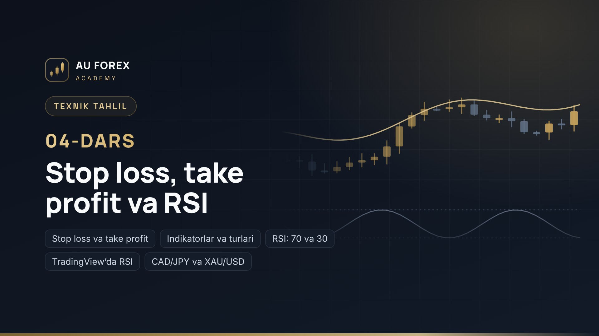

- **Kategoriya:** Texnik tahlil · **Daraja:** Boshlang‘ich · **Davomiyligi:** 31:49 · **Kirish:** PRO (taklif)
- **Muqovadagi sarlavha:** Stop loss, take profit va RSI
- **Qisqa tavsif:** Zararni cheklash (stop loss) va foydani qayd etish (take profit) buyurtmalari, indikatorlar va RSI (nisbiy kuch indeksi) bilan tanishuv.

**Batafsil tavsif.** Dars stop loss va take profit buyurtmalaridan boshlanadi: ular nima uchun kerak va grafikda qayerga qo‘yiladi. So‘ng indikatorlar mavzusi: indikator nima, qanday turlari bor, savdoni avtomatlashtirish (robotlar) haqida qisqacha ma’lumot va nima uchun faqat indikatorga to‘liq tayanib bo‘lmasligi. Asosiy qism — RSI (Relative Strength Index): uni TradingView’da qo‘shish, 70 va 30 darajalarini o‘qish. Misollar CAD/JPY (kunlik) va XAU/USD (1 soatlik va 4 soatlik) grafiklarida ko‘rib chiqiladi.

**Asosiy mavzular:** Stop loss va take profit · Indikatorlar va turlari · RSI: 70 va 30 · TradingView’da RSI · CAD/JPY va XAU/USD

Videodagi dalil: stop loss / take profit ≈05:00–13:30 · indikatorlar ≈13:40–16:00 · RSI ≈16:00 dan oxirigacha (CAD/JPY 1D, XAU/USD 1h/4h); oxirida «keyingi darsda bitta aniq strategiya» deb e’lon qilinadi.

### 05-DARS. Trend strategiyasi: yo‘nalishni aniqlash va savdoga kirish qoidalari

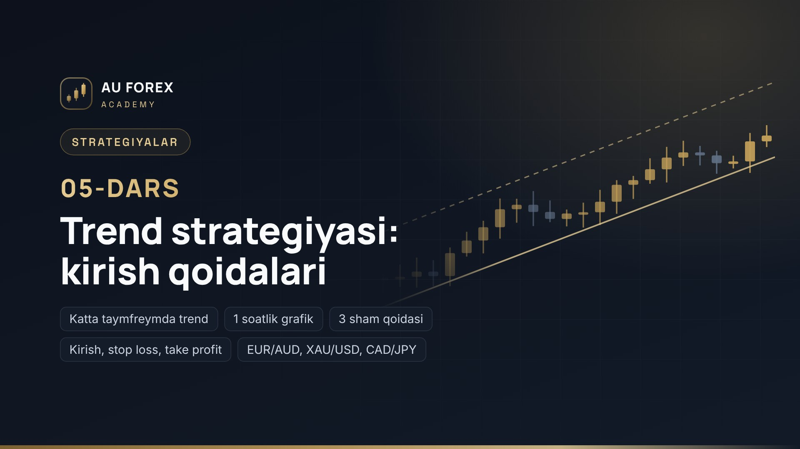

- **Kategoriya:** Strategiyalar · **Daraja:** Boshlang‘ich · **Davomiyligi:** 58:07 · **Kirish:** PRO (taklif)
- **Muqovadagi sarlavha:** Trend strategiyasi: kirish qoidalari
- **Qisqa tavsif:** Trend bo‘yicha savdo qilishning aniq qoidalari: yo‘nalishni katta taymfreymda aniqlash va 1 soatlik grafikda kirish nuqtasini topish.

**Batafsil tavsif.** Ushbu darsda bitta to‘liq strategiya bosqichma-bosqich tushuntiriladi. Avval bozor yo‘nalishi (trend) katta taymfreymda aniqlanadi, savdo esa 1 soatlik grafikda olib boriladi. Trendga qarshi kamida uchta bir xil rangli sham ketma-ket hosil bo‘lgach, ular hosil qilgan daraja buzilishi kirish signali sifatida ko‘riladi; stop loss va take profit qayerga qo‘yilishi ham ko‘rsatiladi. Qoidalar EUR/AUD (4 soatlik), XAU/USD va CAD/JPY (1 soatlik) grafiklarida amalda tekshiriladi.

**Asosiy mavzular:** Katta taymfreymda trend · 1 soatlik grafik · 3 sham qoidasi · Kirish, stop loss, take profit · EUR/AUD, XAU/USD, CAD/JPY

Videodagi dalil: strategiya qoidalari ≈06:30–13:00 · qolgan qismi — EUR/AUD 4h, XAU/USD va CAD/JPY 1h grafiklarida amaliyot va savol-javob.

### 06-DARS. Breakout strategiyasi, Fibonacci va «Power of Three» modeli

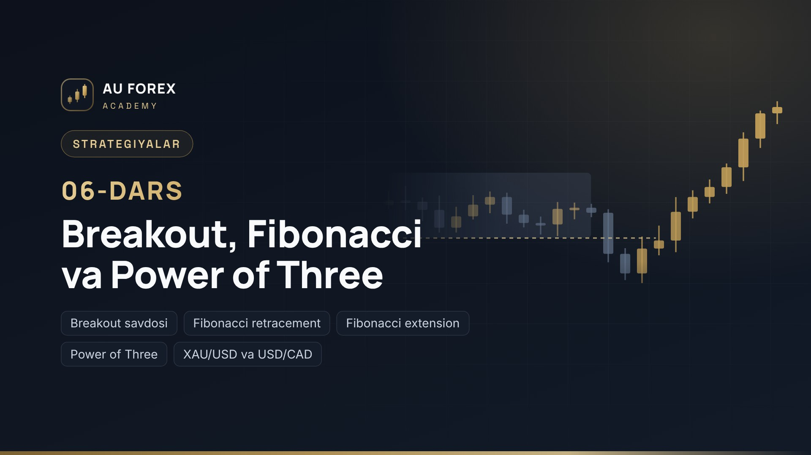

- **Kategoriya:** Strategiyalar · **Daraja:** O‘rta · **Davomiyligi:** 34:23 · **Kirish:** PRO (taklif)
- **Muqovadagi sarlavha:** Breakout, Fibonacci va Power of Three
- **Qisqa tavsif:** Daraja yorib o‘tilganda savdo qilish, Fibonacci vositalari va bozor harakatining uch bosqichli «Power of Three» modeli.

**Batafsil tavsif.** Dars breakout (darajani yorib o‘tish) strategiyasi bilan boshlanadi. Keyin Fibonacci vositalari — retracement (orqaga qaytish darajalari) va extension (harakat davomi uchun maqsadlar) XAU/USD 1 soatlik grafigida chizib ko‘rsatiladi. Ikkinchi qismda «Power of Three» modeli: bozor avval konsolidatsiyada (flat) turadi, so‘ng yolg‘on harakat — manipulyatsiya bo‘ladi va undan keyin asosiy yo‘nalishdagi harakat — distributsiya boshlanadi. Model USD/CAD 1 soatlik grafigida tahlil qilinadi. Dars oxirida uy vazifasi beriladi.

**Asosiy mavzular:** Breakout savdosi · Fibonacci retracement · Fibonacci extension · Power of Three · XAU/USD va USD/CAD

Videodagi dalil: breakout va Fibonacci (retracement/extension) XAU/USD 1h · «Power of Three» (konsolidatsiya → manipulyatsiya → distributsiya) ≈18:30–22:30, USD/CAD 1h · oxirida uy vazifasi.

### 07-DARS. Fundamental tahlil: iqtisodiy kalendar va yangiliklar bilan ishlash

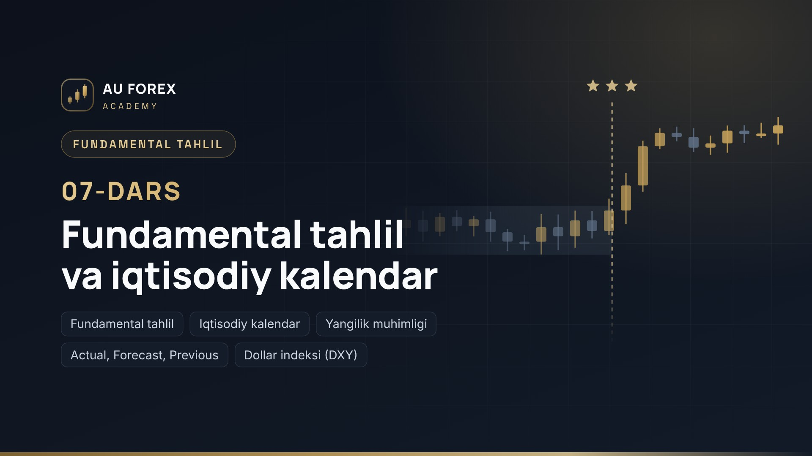

- **Kategoriya:** Fundamental tahlil · **Daraja:** Boshlang‘ich · **Davomiyligi:** 33:14 · **Kirish:** PRO (taklif)
- **Muqovadagi sarlavha:** Fundamental tahlil va iqtisodiy kalendar
- **Qisqa tavsif:** Yangiliklar bozorga qanday ta’sir qilishi va iqtisodiy kalendarni o‘qish: muhim yangiliklarni topish, prognoz va haqiqiy natijani solishtirish.

**Batafsil tavsif.** Fundamental tahlil — bozorda e’lon qilinadigan iqtisodiy va siyosiy yangiliklarga qarab narx harakatini baholash. Darsda Investing.com saytidagi iqtisodiy kalendar (Economic Calendar) bilan ishlash ko‘rsatiladi: vaqt mintaqasini O‘zbekiston vaqtiga (UTC+5) sozlash, yangilikning muhimlik darajasi (yulduzchalar), Actual (haqiqiy), Forecast (prognoz) va Previous (oldingi) ko‘rsatkichlari. Natija prognozdan yuqori yoki past chiqqanda valyuta juftligiga qanday ta’sir qilishi, yangilik vaqtida savdo qilishning xavflari va dollar indeksi (DXY) haqida ham so‘z boradi. Misollar AQSh iqtisodiy yangiliklari va XAU/USD grafigida.

**Asosiy mavzular:** Fundamental tahlil · Iqtisodiy kalendar · Yangilik muhimligi · Actual, Forecast, Previous · Dollar indeksi (DXY)

Videodagi dalil: kirish va kurs rejasi 00:00–06:45 · «bugungi mavzu — fundamental tahlil» 06:47 · Investing.com kalendari ≈08:20–27:30 (UTC+5, yulduzchalar, Actual/Forecast/Previous) · dollar indeksi ≈30:00.

### 08-DARS. Elliott to‘lqinlari va Fibonacci: to‘lqinlar bo‘yicha savdo

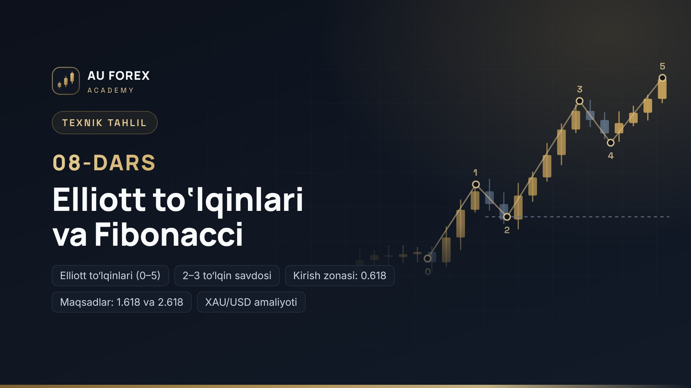

- **Kategoriya:** Texnik tahlil · **Daraja:** O‘rta · **Davomiyligi:** 40:18 · **Kirish:** PRO (taklif)
- **Muqovadagi sarlavha:** Elliott to‘lqinlari va Fibonacci
- **Qisqa tavsif:** Elliott to‘lqinlari va Fibonacci yordamida trend ichida kirish zonasi, stop loss va maqsadlarni aniqlash.

**Batafsil tavsif.** Darsda bozor harakatining Elliott to‘lqinlari bo‘yicha tuzilishi (0 dan 5 gacha nuqtalar) va trend ichida savdo qilish uchun qulay qismlar tushuntiriladi. Asosiy misol — «2–3 savdosi»: 0–1 to‘lqiniga Fibonacci tortiladi va 0.618 darajasi kirish zonasi bo‘ladi, stop loss 0.786 darajasi hududiga qo‘yiladi, maqsadlar esa 1–2 to‘lqiniga tortilgan Fibonacci’ning 1; 1.618 va 2.618 darajalarida belgilanadi. So‘ng 0 dan 5 gacha bo‘lgan to‘liq harakat bo‘yicha savdo ketma-ketligi XAU/USD 1 soatlik grafigida ko‘rib chiqiladi. Uy vazifasi — oltin grafigida shunday tahlilni mustaqil bajarish.

**Asosiy mavzular:** Elliott to‘lqinlari (0–5) · 2–3 to‘lqin savdosi · Kirish zonasi: 0.618 · Maqsadlar: 1.618 va 2.618 · XAU/USD amaliyoti

Videodagi dalil: Elliott to‘lqinlari ≈01:40 · Fibonacci ≈05:15 · ekrandagi yozuv «(2-3) Savdosi: 0-1 → FIBO → 0.618 (kirish zona); SL: 0.786; TP: 1-2 → FIBO → 1, 1.618, 2.618» ≈22:30 · 0–5 to‘liq savdo ≈30:00 · uy vazifasi ≈32:40.

### 09-DARS. Likvidlik: buy-side, sell-side va likvidlikning olinishi

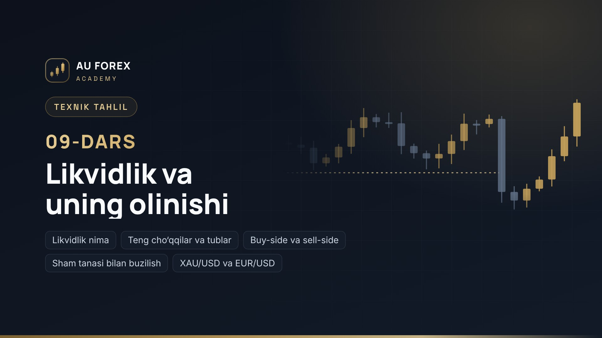

- **Kategoriya:** Texnik tahlil · **Daraja:** O‘rta · **Davomiyligi:** 62:25 · **Kirish:** PRO (taklif)
- **Muqovadagi sarlavha:** Likvidlik va uning olinishi
- **Qisqa tavsif:** Bozordagi likvidlik — stop buyurtmalar to‘plangan joylar: ularni grafikda topish va likvidlik olinmaguncha savdoga shoshilmaslik.

**Batafsil tavsif.** Likvidlik (liquidity) atamasining tradingdagi ma’nosi: bir necha marta tegilgan cho‘qqilar va tublar ortida treyderlarning stop buyurtmalari to‘planadi va narx ko‘pincha avval shu joylardagi likvidlikni olib o‘tadi. Darsda buy-side va sell-side likvidlik, kunlik shamning maksimum va minimumlari hamda trend chizig‘i likvidligi ko‘rsatiladi. Daraja faqat sham tanasi bilan yopilganda buzilgan hisoblanishi, likvidlik olinmaguncha savdoga kirmaslik qoidasi va savdo sessiyalarining ta’siri ham eslatib o‘tiladi. Darsning ikkinchi yarmida o‘quvchilarning uy vazifalari XAU/USD va EUR/USD grafiklarida tahlil qilinadi.

**Asosiy mavzular:** Likvidlik nima · Teng cho‘qqilar va tublar · Buy-side va sell-side · Sham tanasi bilan buzilish · XAU/USD va EUR/USD

Videodagi dalil: likvidlik ta’rifi ≈07:30–12:30 · buy-side/sell-side ≈16:50–19:50 · uy vazifalari tahlili ≈30:50–46:00 · sessiyalar ≈46:55 · «sham tanasi bilan buzilish» ≈48:45 · XAU/USD 1D/1h, EUR/USD.

### 10-DARS. Order blok va bozor strukturasi: BOS, CHoCH va breaker blok

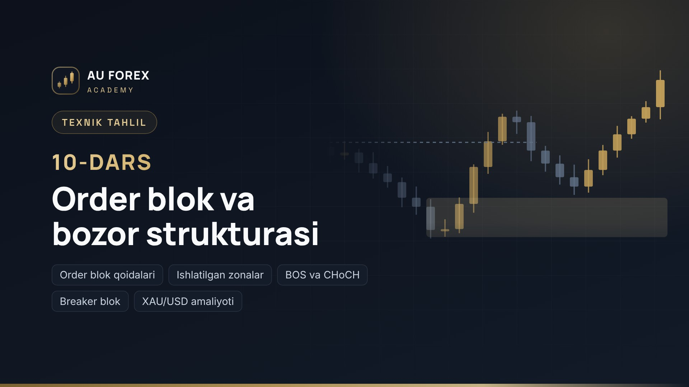

- **Kategoriya:** Texnik tahlil · **Daraja:** Yuqori · **Davomiyligi:** 42:55 · **Kirish:** PRO (taklif)
- **Muqovadagi sarlavha:** Order blok va bozor strukturasi
- **Qisqa tavsif:** Order blok — kuchli harakat boshlangan zona: uni to‘g‘ri belgilash qoidalari va bozor strukturasidagi BOS hamda CHoCH bilan birga ishlatish.

**Batafsil tavsif.** Smart Money yondashuvining asosiy tushunchalaridan biri — order blok. Darsda sham chizmalari orqali kuchli impulsdan oldingi oxirgi qarama-qarshi sham qanday qilib order blokka aylanishi, uning chegaralari qanday belgilanishi va qaysi holatlarda order blokdan foydalanib bo‘lmasligi tushuntiriladi. Narx bir marta qaytib ishlatgan zonadan qayta foydalanilmasligi ham ko‘rsatiladi. So‘ng bozor strukturasi: BOS (struktura buzilishi) va CHoCH (xarakter o‘zgarishi), shuningdek breaker blok tushunchasi. Barcha misollar XAU/USD 30 daqiqalik va 1 soatlik grafiklarida.

**Asosiy mavzular:** Order blok qoidalari · Ishlatilgan zonalar · BOS va CHoCH · Breaker blok · XAU/USD amaliyoti

Videodagi dalil: order blok sham chizmalari va qoidalari ≈04:30–13:00 · «struktura buzilishi, xarakter o‘zgarishi» (BOS/CHoCH) ≈24:50–30:00 · breaker blok ≈37:50 · XAU/USD 30m/1h.

### 11-DARS. Amaliy tahlil: iqtisodiy yangiliklar, order blok va Fibonacci

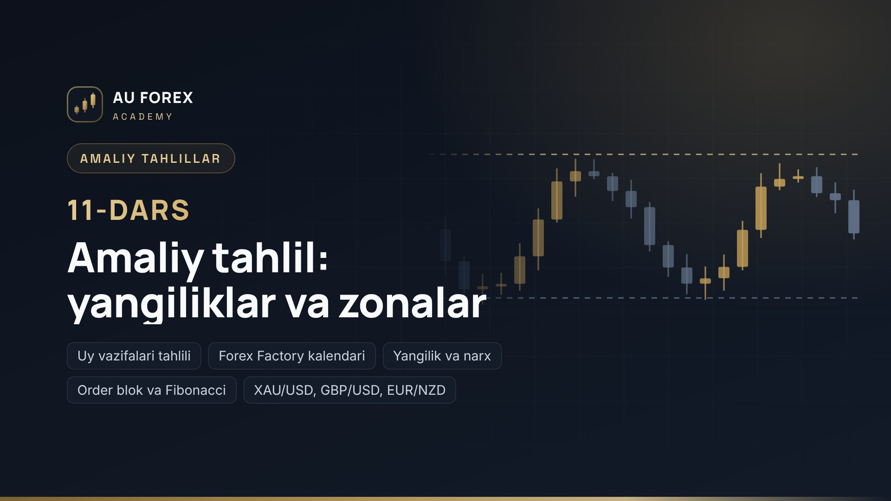

- **Kategoriya:** Amaliy tahlillar · **Daraja:** O‘rta · **Davomiyligi:** 35:43 · **Kirish:** PRO (taklif)
- **Muqovadagi sarlavha:** Amaliy tahlil: yangiliklar va zonalar
- **Qisqa tavsif:** O‘tilgan mavzularni amalda qo‘llash: iqtisodiy kalendar bo‘yicha yangiliklarni kuzatish va grafikda order blok hamda Fibonacci zonalarini topish.

**Batafsil tavsif.** Amaliy mashg‘ulot. Avval o‘quvchilarning uy vazifalari ko‘rib chiqiladi. So‘ng Investing.com va Forex Factory iqtisodiy kalendarlarida haftaning muhim yangiliklari topiladi, yangilik chiqishidan oldin va keyin bozor qanday harakatlanishi muhokama qilinadi. Grafik tahlilida order blok, Fibonacci darajalari, konsolidatsiya va Elliott to‘lqinlari birga qo‘llanadi. Misollar XAU/USD (1 soatlik va kunlik), GBP/USD va EUR/NZD grafiklarida.

**Asosiy mavzular:** Uy vazifalari tahlili · Forex Factory kalendari · Yangilik va narx · Order blok va Fibonacci · XAU/USD, GBP/USD, EUR/NZD

Videodagi dalil: uy vazifalari ≈00:00–04:00 · Investing.com kalendari (ekran 00:00–01:00) · Forex Factory ≈17:30–18:30 · order blok, Fibonacci, Elliott ≈21:00–24:30 · XAU/USD, GBP/USD, EUR/NZD.

> Tekshirish kerak: Amaliy dars — bir nechta mavzu aralash; nom umumiy qilib berildi.

### 12-DARS. Amaliy mashg‘ulot: order blokni tez va to‘g‘ri topish

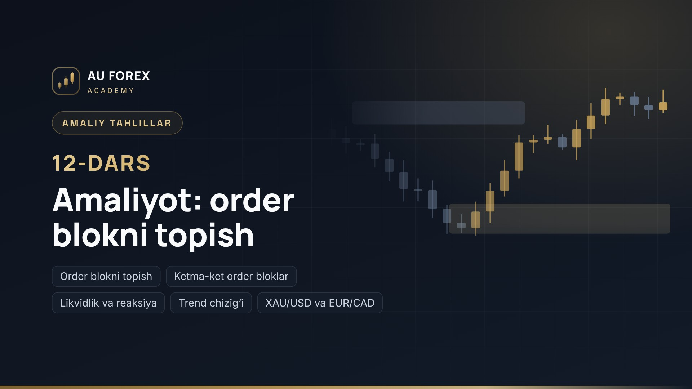

- **Kategoriya:** Amaliy tahlillar · **Daraja:** O‘rta · **Davomiyligi:** 26:26 · **Kirish:** PRO (taklif)
- **Muqovadagi sarlavha:** Amaliyot: order blokni topish
- **Qisqa tavsif:** Birinchi amaliy dars: grafikda order blokni tez va to‘g‘ri topish, uni likvidlik va trend chizig‘i bilan birga baholash.

**Batafsil tavsif.** Kursning birinchi amaliy mashg‘uloti. Order blokdan foydalanish qoidalari qisqacha takrorlanadi va o‘quvchilarning vazifalari tekshiriladi. Bir nechta order blok ketma-ket kelganda qaysi biri tanlanishi, likvidlik olingandan keyingi reaksiya va trend chizig‘i bilan tasdiqlash ko‘rsatiladi. Misollar XAU/USD (30 daqiqalik va 1 soatlik) hamda EUR/CAD (1 soatlik) grafiklarida; EUR/CAD misolida order blok, sell-side likvidlik (SSL) va BISI (FVG) zonasi birga belgilanadi. Dars oxirida uy vazifasi beriladi.

**Asosiy mavzular:** Order blokni topish · Ketma-ket order bloklar · Likvidlik va reaksiya · Trend chizig‘i · XAU/USD va EUR/CAD

Videodagi dalil: «bugun birinchi praktika darsimiz» 00:03 · order blok qoidalari ≈01:00–05:30 · ketma-ket order bloklar ≈12:00 · likvidlik ≈15:00 · trend chizig‘i ≈16:25 · EUR/CAD 1h (ekranda OB, SSL, BISI) ≈18:00.

### 13-DARS. Bozor strukturasi: BOS va tasdiq bilan savdoga kirish

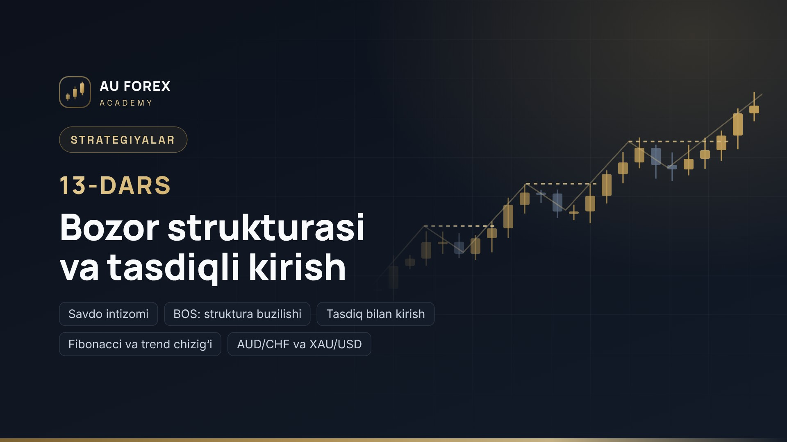

- **Kategoriya:** Strategiyalar · **Daraja:** Yuqori · **Davomiyligi:** 36:01 · **Kirish:** PRO (taklif)
- **Muqovadagi sarlavha:** Bozor strukturasi va tasdiqli kirish
- **Qisqa tavsif:** Bozor strukturasini (BOS) o‘qish va savdoga faqat tasdiq bilan kirish: bir nechta usulni bitta tahlilda birlashtirish.

**Batafsil tavsif.** Dars savdo intizomi haqidagi suhbatdan boshlanadi: kuniga nechta bitim ochish va kamida ikkita sabab bo‘lmasa savdoga kirmaslik qoidasi. Asosiy mavzu — Smart Money yondashuvidagi bozor strukturasi: ko‘tarilish va pasayishda BOS (struktura buzilishi) qanday belgilanadi, struktura buzilgandan keyin narx orqaga qaytganda kirish nuqtasi qanday topiladi. Kirishni tasdiqlash uchun Fibonacci va trend chizig‘ining buzilishi qo‘shiladi — ikki-uch usulni bir-biriga moslashtirish ko‘rsatiladi. Misollar AUD/CHF (1 soatlik va 30 daqiqalik) va XAU/USD grafiklarida.

**Asosiy mavzular:** Savdo intizomi · BOS: struktura buzilishi · Tasdiq bilan kirish · Fibonacci va trend chizig‘i · AUD/CHF va XAU/USD

Videodagi dalil: savdo intizomi ≈03:10 · BOS va struktura ≈07:00–19:20 · Fibonacci ≈20:30–22:30 · «2–3 strategiyani moslashtirish» ≈22:00 · trend chizig‘i ≈24:10–25:00 · AUD/CHF 1h/30m, XAU/USD.

### 14-DARS. Fibonacci va likvidlik: BSL va SSL oralig‘idagi zonalar

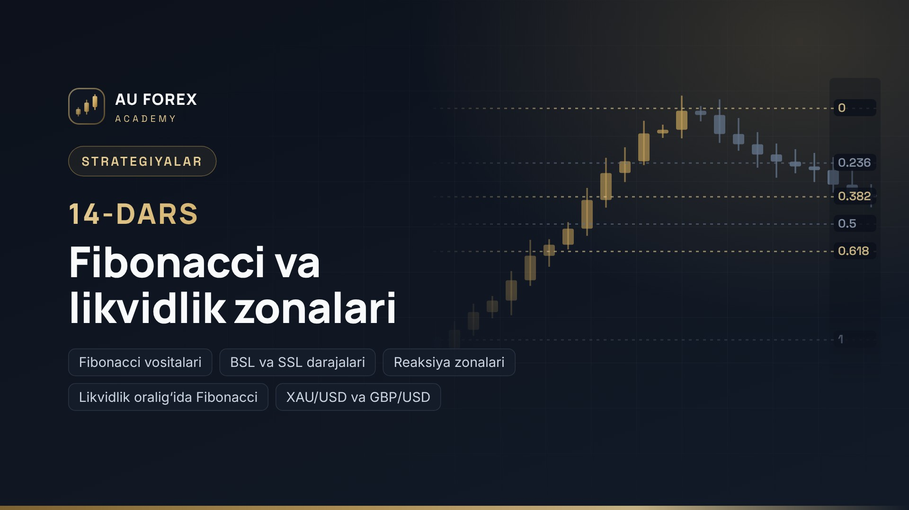

- **Kategoriya:** Strategiyalar · **Daraja:** O‘rta · **Davomiyligi:** 28:27 · **Kirish:** PRO (taklif)
- **Muqovadagi sarlavha:** Fibonacci va likvidlik zonalari
- **Qisqa tavsif:** Fibonacci’ni likvidlik darajalari bilan birga qo‘llash: avval BSL va SSL belgilanadi, so‘ng ular oralig‘ida reaksiya zonalari topiladi.

**Batafsil tavsif.** Dars avvalgi kungi yangilikdan keyingi oltin (XAU/USD) harakatini ko‘rib chiqishdan boshlanadi. So‘ng Fibonacci’ning yana bir qo‘llanish usuli o‘rganiladi: grafikda avval buy-side (BSL) va sell-side (SSL) likvidlik darajalari belgilanadi, Fibonacci shu oraliqqa tortiladi va narx reaksiya beradigan zonalar aniqlanadi. TradingView’dagi Fibonacci vositalari (retracement, trend-based extension va boshqalar) ko‘rsatiladi. Misollar XAU/USD va GBP/USD 1 soatlik grafiklarida; dars oxirida uy vazifalari tahlil qilinadi.

**Asosiy mavzular:** Fibonacci vositalari · BSL va SSL darajalari · Reaksiya zonalari · Likvidlik oralig‘ida Fibonacci · XAU/USD va GBP/USD

Videodagi dalil: kechagi yangilikdan keyingi harakat ≈06:55 · buy-side/sell-side ≈10:20 · TradingView Fibonacci menyusi ≈12:00 · GBP/USD 1h (ekranda FIBO zonasi, BSL, SSL) ≈20:00–20:45 · uy vazifalari ≈24:35.

> Tekshirish kerak: Fibonacci qaysi darajalar bilan qo‘llangani nutqdan to‘liq aniq eshitilmadi; tavsif ekrandagi chizmalarga (BSL, SSL, FIBO zonasi) tayanadi — tasdiqlang.

### 15-DARS. Inducement (IDM): likvidlik tuzog‘i va tasdiq bilan kirish

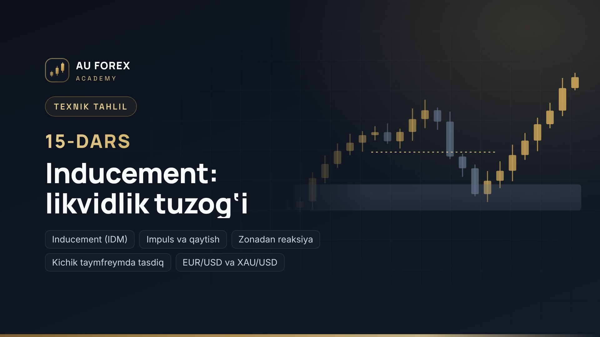

- **Kategoriya:** Texnik tahlil · **Daraja:** Yuqori · **Davomiyligi:** 31:35 · **Kirish:** PRO (taklif)
- **Muqovadagi sarlavha:** Inducement: likvidlik tuzog‘i
- **Qisqa tavsif:** Inducement — narx asosiy zonaga yetishidan oldin olinadigan «tuzoq» likvidlik: uni belgilash va kichik taymfreymdagi tasdiq bilan savdoga kirish.

**Batafsil tavsif.** Smart Money yondashuvidagi inducement (IDM) tushunchasi: impulsdan keyingi birinchi kichik qaytish nuqtasi treyderlarni erta kirishga undaydi, narx esa ko‘pincha avval shu likvidlikni olib, keyin asosiy zonadan (order blokdan) reaksiya beradi. Darsda IDM’ni grafikda belgilash, u olinmaguncha savdoga shoshilmaslik va zona ishlagach kichik taymfreymga o‘tib tasdiq bilan kirish ko‘rsatiladi. Impuls va qaytish (korreksiya) harakatlarini ajratish ham muhokama qilinadi. Misollar EUR/USD va XAU/USD grafiklarida.

**Asosiy mavzular:** Inducement (IDM) · Impuls va qaytish · Zonadan reaksiya · Kichik taymfreymda tasdiq · EUR/USD va XAU/USD

Videodagi dalil: inducement ≈05:15–15:20 · ikkinchi qism ≈22:45 dan: zonadan keyin kichik taymfreymda tasdiq ≈23:35 · EUR/USD (kichik taymfreymlar), XAU/USD.

> Tekshirish kerak: Nutqda «indus…» deb eshitiladi — Smart Money atamasi inducement (IDM) deb talqin qilindi. Tasdiqlang.

## 6. Mualliflik huquqi va shaxsiy ma’lumotlar

> Bu yuridik xulosa emas — videolarda ko‘ringan holatlar ro‘yxati. Vaqtlar 30 soniyalik kadrlar bo‘yicha taxminiy; qirqishdan oldin aniq chegaralar ko‘rib chiqiladi.

### 6.1. Huquq bo‘yicha savollar (javob kerak)

1. **Darslardan foydalanish huquqi.**
   - Avval faqat 1–3-darslar uchun huquq va rozilik tasdiqlangan.
   - 4–15-darslar ham Telegram’dagi «Online course» guruhining jonli video-qo‘ng‘iroq yozuvlari. Taqdimotchi — kurs muallifi.
   - Ularni AU Forex Academy saytida (PRO, pullik) tarqatish huquqi borligini yozma tasdiqlash kerak.
2. **Ishtirokchilar roziligi.**
   - Qo‘ng‘iroqda 2–3 o‘quvchi gapiradi.
   - Ularning ismlari qo‘ng‘iroq oynasida ko‘rinadi («… is speaking»), ovozlari yozuvda bor.
   - Ularning roziligi kerak yoki bu qismlarni yashirish kerak.
3. **Boshqa brend.**
   - 12 va 14-darslardagi Telegram ro‘yxatida «Ake Fx» nomli kanallar ko‘rinadi.
   - Darslar boshqa loyiha uchun yozilgan bo‘lsa, o‘sha loyiha egasining ruxsati kerak.
4. **Uchinchi tomon materiallari.**
   - TradingView grafiklari: logotip ko‘rinib turadi, odatiy foydalanish.
   - Investing.com va Forex Factory sahifalari ulardagi reklama bannerlari bilan ko‘rinadi.
   - Boshqa shaxslarning grafik rasmlari ko‘rinadi: 9-dars ≈56:00 (boshqa muallifning kriptovalyuta grafigi), 13-dars ≈34:30 (boshqa foydalanuvchining TradingView nomi).
   - Bu ikki joyni qirqish tavsiya etiladi.

### 6.2. Albatta olib tashlash tavsiya etiladi (saytning neytral ta’lim siyosatiga zid yoki maxfiy)

| Dars | Vaqt | Nima ko‘rinadi / eshitiladi |
|---|---|---|
| 12 | ≈19:00, ≈23:30–25:30 | Telegram’dagi signal kanali: «robot natijasi», depozit va foyda summalari (daromad va’dasi kabi ko‘rinadi) |
| 14 | ≈25:00–26:30 | Telegram signal kanali: jonli BUY/SELL signallari. Shaxsiy chatlar ro‘yxatida to‘liq ismlar va o‘quv muassasasi chati |
| 13 | ≈01:50–06:00 | Shaxsiy savdo natijalari haqida suhbat: dollar summalarida foyda/zarar |
| 15 | ≈01:00 | TradingView ogohlantirishi: boshqa qurilmaning **IP manzili** ko‘rinadi |
| 05 | ≈01:30, ≈20:30–21:30 | Telegram: shaxsiy va guruh chatlari ro‘yxati, signal kanallari nomlari |
| 06 | ≈29:30–34:30 | YouTube qidiruvi; Telegram shaxsiy va guruh chatlari (shaxsiy xabarlar) |
| 10 | ≈34:00 | Telegram: shaxsiy va guruh chatlari ro‘yxati |
| 12 | ≈08:00, ≈18:30–19:30 | Telegram: shaxsiy va guruh chatlari ro‘yxati |

### 6.3. Ko‘rib chiqish tavsiya etiladi

| Dars | Vaqt | Holat |
|---|---|---|
| 07 | ≈04:45–06:45 | Kurs rejasi: keyingi bosqichda real hisob ochish va pul yechish haqida gap — real pul bilan savdoga undash kabi qabul qilinishi mumkin |
| 15 | ≈13:30 | Kichik depozit bilan lot ochish haqidagi gap — risk bo‘yicha noto‘g‘ri tushunilishi mumkin |
| 09 | ≈31:30–37:30, ≈55:30–56:30 | Kurs guruhining Telegram chati: o‘quvchilar xabarlari va ismlari |
| 15 | ≈02:00–08:30 | Kurs guruhining Telegram chati |
| 08, 13 | 08: ≈34:30, ≈39:00 · 13: ≈34:00 | Kurs guruhining Telegram chati (qisqa) |
| 04 | ≈04:00, ≈06:30 | Ish stolidagi eslatmalar oynasi; Telegram |
| 08 | ≈10:30 | TradingView’dagi broker reklamasi |
| 07, 11 | 07: ≈12:00–13:00 · 11: ≈13:00, ≈17:30 | Sayt reklamalari (chegirma, broker banneri) |
| 14 | ≈19:00–20:00 | Brauzer yorliqlarida savdo-robot reklamalari |
| Barchasi | Butun video | Qo‘ng‘iroq oynasida ishtirokchilar ismlari; macOS tizim ogohlantirishlari |

### 6.4. Tuzatish usullari (tanlash kerak)

- **A. Qirqish, sifat o‘zgarmaydi.**
  - Kerakli bo‘laklar qayta kodlashsiz kesib tashlanadi.
  - Kesish nuqtasi faqat kalit kadrlarga to‘g‘ri keladi: bu videolarda oraliq o‘rtacha 12 s, eng ko‘pi 27 s.
  - Natijada kesim bir necha soniya kengroq bo‘ladi.
- **B. Aniq qirqish yoki xiralashtirish (blur).**
  - Videoni yuqori sifatda (vizual farqsiz) qayta kodlash kerak.
  - Bu sifatni o‘zgartirish hisoblanadi, shuning uchun alohida ruxsatingiz kerak.
  - Butun video bo‘ylab qo‘ng‘iroq oynasidagi ismlarni yashirish ham faqat shu usulda mumkin.
- **C. O‘zgarishsiz.** Huquq egasi va ishtirokchilar yozma rozi bo‘lsa. 6.2 dagi daromad va signal qismlari baribir neytral ta’lim siyosatiga zid.

## 7. Keyingi qadamlar

1. Tasdiqlashingiz kerak bo‘lgan narsalar:
   - nomlar, tavsiflar, kategoriyalar va darajalar;
   - muqovalar;
   - PRO/Bepul taqsimoti.
2. 6.1-bo‘limdagi huquq va rozilik bo‘yicha javob kerak.
3. 6.4-bo‘limdan tuzatish usulini tanlang: A, B yoki C.
4. Shundan keyin darslar avval Preview muhitida R2 orqali import qilinadi va tekshiriladi: ijro, ovoz, progress, mobil.
5. Production’ga import faqat alohida ruxsatingiz bilan bajariladi.
6. 17–32-darslar papkaga yuklansa, ular ham xuddi shu tartibda tayyorlanadi.
